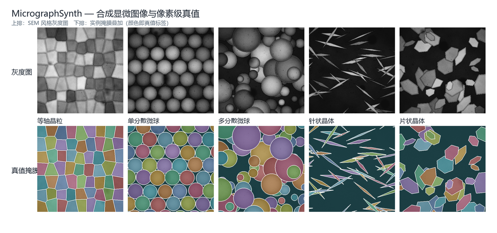

# MicrographSynth

**合成显微图像 + 像素级真值。给分割模型一个不需要标注的数据源。**




上排是 SEM 风格的灰度图，下排是同一场景的实例掩膜叠加——**颜色就是真值标签**，不是模型预测出来的。

## 为什么需要它

做显微图像分割的人都会撞上同一堵墙：**标注太贵**。

- 一张 512×512 的显微图，专家手工勾晶界要十几分钟，几百张才够训一个模型；
- 真实样品数据往往因为产线、客户或保密原因不能公开，想复现别人的结果很难；
- 评测也缺真值——"分割得好不好"最后只能靠肉眼打分。

合成数据的价值在于：**真值免费、可无限生成、且完全可控**。你可以精确控制晶粒尺寸分布、孔隙率、球径分布、噪声水平，再去测模型在这些条件下到底哪一步先崩。

## 能生成什么

| 预置 | 样品类型 | 形态 |
| --- | --- | --- |
| `grains` | 等轴晶粒 | 带扰动的 Voronoi 镶嵌，晶界有刻蚀沟槽 |
| `spheres-mono` | 单分散微球 | 密排单层，粒径集中（±4%） |
| `spheres-poly` | 多分散微球 | 宽粒径分布，小颗粒填充球隙 |
| `needles` | 针状晶体 | 两端尖锐的透镜形，随机取向、互相穿插 |
| `plates` | 片状晶体 | 六方板状，带倾角（透视缩短） |

## 快速开始

```bash
pip install -e .

# 生成 8 张等轴晶粒图像
micrograph-synth --preset grains --count 8 --size 512 --out data/grains
```

也可以直接跑模块：

```bash
python -m micrograph_synth.cli --preset spheres-poly --count 12 --out data/beads
```

一条命令输出图像、真值掩膜、叠加图、逐实例统计和一张预览图：

```
data/grains/
├── grains_000.png            # SEM 风格灰度图
├── grains_000_mask.png       # 真值实例掩膜（调色板 PNG）
├── grains_000_overlay.png    # 掩膜叠加，用于肉眼检查
├── ...
├── instances.csv             # 每个颗粒一行：面积、等效直径、长宽比、取向…
├── dataset.json              # 本次生成的参数与说明
└── preview.png               # 缩略图墙
```

## 参数

| 参数 | 默认 | 说明 |
| --- | --- | --- |
| `--preset` | `grains` | 五选一，见上表 |
| `--count` | 8 | 生成多少张 |
| `--size` | 512 | 边长（像素，正方形） |
| `--seed` | 0 | 随机种子。**同种子必得同数据**，方便复现实验 |
| `--pixel-size-um` | 0.2 | 单像素对应多少微米，只影响统计结果里的物理单位 |
| `--noise` | 0.05 | 探测器噪声幅度 |
| `--pits` | 90 | 每张图的蚀坑 / 麻点数 |

## 自检

```bash
pip install -e . pytest
make test        # pytest：确定性、形状、统计合法性
make e2e         # 真跑一次 CLI，确认入口可用
make showcase    # 重新生成 docs/showcase.png
```

## 输出约定

- **掩膜**是调色板 PNG：`0` 为背景，实例 `i` 使用调色板索引 `i % 255 + 1`；叠加图里同色即同实例。
- **instances.csv** 的列：`sample, label, area_px, area_frac, eq_diameter_px, eq_diameter_um, major_px, minor_px, aspect_ratio, orientation_deg, centroid_x, centroid_y`。
- 所有几何量都直接从标签图算出来，不经过"预测—反推"，所以真值是精确的。

## 实现思路

1. **先有标签，再有图像**。场景先在整数标签图上排布实例（Voronoi 镶嵌、圆、菱形、六边形），再根据标签渲染灰度图——所以掩膜和图像严格对齐，不存在"标注偏一两个像素"的问题。
2. **二次电子风格**。每个实例按法线近似做明暗，边缘加亮（SE 边缘效应），晶界处压出暗沟，再叠上孔隙、蚀坑、探测器噪声和暗角。
3. **尺寸场驱动细节**。每个像素记录到实例边界的归一化距离，边缘高光、沟槽宽度、板状晶体的倾角都由这个距离场推出来。
4. **确定性**。全部随机性来自 `numpy.random.default_rng(seed)`，同一 seed 在任意机器上生成同一批数据。

## 适合用来做什么

- **预训练 / 数据增强**：先用合成数据把分割网络训到一个像样的起点，再用少量真实标注微调。
- **条件实验**：固定其它变量，只改粒径分布或噪声，看模型在哪个区间失效。
- **评测基准**：合成数据有精确真值，可以算像素级 IoU / Dice，也可以算实例级的检出率与直径误差。
- **教学与工具测试**：验证一条定量分析流水线（分割 → 粒径统计）在已知答案下是否算对。

## 局限

这是**模拟**，不是测量：

- 没有建模荷电效应、探测器点扩散、样品制备损伤等真实成像细节；
- 晶粒是 Voronoi 近似，没有模拟真实的晶粒长大与孪晶；
- 不能替代真实样品数据，也不应把合成图当作实验观测结果发表。

建议的用法是**混着用**：合成数据扩样本、真实数据定标准。

## 路线图

- [ ] 更多形态：枝晶、团聚体、多相组织（基体 + 第二相 + 孔洞）
- [ ] 导出 COCO / YOLO / Cityscapes 标注格式
- [ ] 域随机化：亮度、对比度、模糊、扫描线、亮度不均
- [ ] 附带一个零样本评测脚本（Cellpose / SAM 在合成图上的表现）

## 许可

MIT，见 [LICENSE](LICENSE)。
